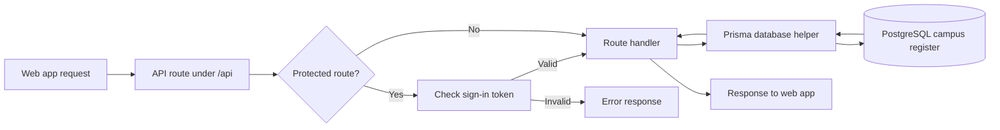
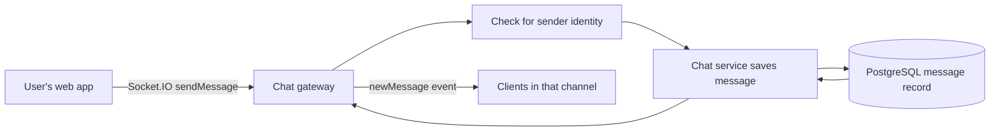

# IIIT NR Workshop Campus API

This repository contains the backend intended for the IIIT NR Workshop campus web app for IIIT Naya Raipur. The code provides services for account access, campus information, work listings, AI chat, messaging, and call support. The frontend checkout is not present here, so its connection to this backend is **UNVERIFIED**.

> **Security notice:** Git tracks [`.gmail_session.json`](.gmail_session.json), which contains populated OAuth token fields. [`prisma/seed.ts`](prisma/seed.ts) contains a default administrator credential and prints it when the seed script runs. Hard-coded JWT fallback secrets are also present in [`src/modules/iam/iam.module.ts`](src/modules/iam/iam.module.ts) and [`src/modules/ai/ai.module.ts`](src/modules/ai/ai.module.ts). No values are reproduced here. Treat exposed credentials as compromised: revoke or rotate them, remove them from the repository and its history, and replace or secure the seed credentials before deployment.

## What it is

The Campus API is a **NestJS** server written in **TypeScript**. It listens on port `4000` by default and places HTTP API routes under `/api`. An API is like a service counter: the web app makes a request, and this service returns information or performs an action. The startup and route-prefix settings are in [`src/main.ts`](src/main.ts).

The app is divided into feature areas such as identity, university services, chat, freelance listings, and AI in [`src/app.module.ts`](src/app.module.ts). The repository does not include the frontend checkout, so the exact browser screens and their live use of these services are **UNVERIFIED**.

## What it does for the app (plain words)

For a student or teacher, this backend is the behind-the-scenes office that can:

- Help people register, sign in, confirm an email, and link a campus account ([`src/modules/iam/controllers/auth.controller.ts`](src/modules/iam/controllers/auth.controller.ts)).
- Store and serve campus items such as notices, events, assignments, attendance, notes, and questions ([`src/modules/university/controllers/university.controller.ts`](src/modules/university/controllers/university.controller.ts)).
- Provide campus discussion channels, direct conversations, message history, and file uploads ([`src/modules/chat/chat.controller.ts`](src/modules/chat/chat.controller.ts), [`src/modules/chat/chat.gateway.ts`](src/modules/chat/chat.gateway.ts)).
- List and create freelance gigs ([`src/modules/freelance/controllers/freelance.controller.ts`](src/modules/freelance/controllers/freelance.controller.ts)).
- Offer an authenticated AI chat endpoint ([`src/modules/ai/controllers/ai.controller.ts`](src/modules/ai/controllers/ai.controller.ts)).
- Issue a LiveKit access token for a named call room when the required server credentials are configured ([`src/modules/chat/chat.controller.ts`](src/modules/chat/chat.controller.ts)).

## Features (exists / partial / missing)

These labels describe backend code found in this repository, not whether a complete user-facing feature is connected or deployed.

| Feature | Status | What the code shows |
|---|---|---|
| Account access | **Exists** | Registration, email one-time codes, password operations, Google sign-in, profile lookup, and campus-account linking are represented in the authentication controller and service ([`src/modules/iam/controllers/auth.controller.ts`](src/modules/iam/controllers/auth.controller.ts), [`src/modules/iam/services/auth.service.ts`](src/modules/iam/services/auth.service.ts)). External email and Google configuration is needed for those integrations. |
| Campus information and administration | **Exists** | Routes cover notices, events, assignments, attendance, notes, questions, and administrator overview/user data ([`src/modules/university/controllers/university.controller.ts`](src/modules/university/controllers/university.controller.ts), [`src/modules/university/controllers/admin.controller.ts`](src/modules/university/controllers/admin.controller.ts)). |
| Chat and file sharing | **Exists** | The code includes stored messages, channels and direct chats, a Socket.IO gateway, and file upload/download endpoints ([`src/modules/chat/chat.service.ts`](src/modules/chat/chat.service.ts), [`src/modules/chat/chat.gateway.ts`](src/modules/chat/chat.gateway.ts), [`src/modules/chat/chat.controller.ts`](src/modules/chat/chat.controller.ts)). |
| Voice/video calls | **Partial** | The gateway relays call-related events and the API can issue a LiveKit room token. A LiveKit service and a working frontend call flow are not included in this repository ([`src/modules/chat/chat.gateway.ts`](src/modules/chat/chat.gateway.ts), [`src/modules/chat/chat.controller.ts`](src/modules/chat/chat.controller.ts)). |
| AI chat | **Partial** | Authenticated chat and API-key validation routes exist; the AI service uses Gemini and needs a configured key for server-side requests ([`src/modules/ai/controllers/ai.controller.ts`](src/modules/ai/controllers/ai.controller.ts), [`src/modules/ai/services/ai.service.ts`](src/modules/ai/services/ai.service.ts)). |
| Freelance work | **Partial** | The API lists and creates gigs. Proposal and escrow data models exist, but this repository has no corresponding freelance controller endpoints ([`src/modules/freelance/controllers/freelance.controller.ts`](src/modules/freelance/controllers/freelance.controller.ts), [`prisma/schema/freelance.prisma`](prisma/schema/freelance.prisma)). A complete proposal/escrow API is therefore **missing from the exposed backend routes**. |
| Frontend integration | **UNVERIFIED** | The backend allows the known local and deployed frontend origins, but the frontend source was not available here to check its API base URL, event names, or call-token use ([`src/main.ts`](src/main.ts), [`src/modules/chat/chat.gateway.ts`](src/modules/chat/chat.gateway.ts)). |

No product requirements document was found in this checkout. Other product-level “missing” features cannot be determined from backend code alone.

## How it works

### A protected API request

The diagram follows one common protected request. Some routes are public and do not require the authentication step.



NestJS routes are grouped by feature, and selected routes use a JWT authentication guard. Data access is handled through Prisma and PostgreSQL ([`src/app.module.ts`](src/app.module.ts), [`src/modules/iam/guards/jwt-auth.guard.ts`](src/modules/iam/guards/jwt-auth.guard.ts), [`src/prisma.service.ts`](src/prisma.service.ts), [`prisma/schema/base.prisma`](prisma/schema/base.prisma)). A database is like the college register; Prisma is the clerk that translates the service's requests into register lookups and updates.

### A chat message



The gateway verifies a JWT if a token is supplied during connection, checks for a sender identity when handling a message, stores accepted messages through the chat service, and emits the saved message to the channel ([`src/modules/chat/chat.gateway.ts`](src/modules/chat/chat.gateway.ts), [`src/modules/chat/chat.service.ts`](src/modules/chat/chat.service.ts)). Socket.IO is like an open intercom: it can deliver updates immediately instead of waiting for the app to ask for a fresh page.

## Tools used

“Why chosen” below means the role visible in this codebase. The original selection rationale is not recorded and is **UNVERIFIED**.

| Tool | What it is | Why chosen / role visible here |
|---|---|---|
| NestJS | A framework for organizing a Node.js server into feature areas. | Groups controllers and services for the API ([`src/app.module.ts`](src/app.module.ts)). |
| TypeScript | JavaScript with checks for the shapes of values. | Used for the server code under `src/`; package and compiler settings are in [`package.json`](package.json) and [`tsconfig.json`](tsconfig.json). |
| PostgreSQL and Prisma | PostgreSQL is the data store; Prisma is a typed helper for reading and writing it. | The schema uses PostgreSQL and Prisma models for campus data ([`prisma/schema/base.prisma`](prisma/schema/base.prisma), [`src/prisma.service.ts`](src/prisma.service.ts)). |
| Socket.IO | A library for two-way, near-instant messages between server and connected apps. | Powers the chat gateway and its live message/presence events ([`src/modules/chat/chat.gateway.ts`](src/modules/chat/chat.gateway.ts)). |
| LiveKit server SDK | A library that creates signed permissions for call rooms. | Used by the chat controller to create call access tokens ([`src/modules/chat/chat.controller.ts`](src/modules/chat/chat.controller.ts)). |
| Google OAuth and Gmail APIs | Google sign-in and campus Gmail connection services. | The code includes Google sign-in and Google Gmail integration routes/services ([`src/modules/iam/strategies/google.strategy.ts`](src/modules/iam/strategies/google.strategy.ts), [`src/modules/university/services/google-gmail.service.ts`](src/modules/university/services/google-gmail.service.ts)). |
| Resend | A service for sending email. | Used by the mail service to deliver verification codes when configured ([`src/modules/iam/services/mail.service.ts`](src/modules/iam/services/mail.service.ts)). |
| Upstash Redis | A hosted, fast key-value store. | Can store short-lived email verification codes; the code falls back to in-memory storage when Redis is not configured ([`src/modules/iam/services/otp.service.ts`](src/modules/iam/services/otp.service.ts)). |
| Gemini | Google's AI model service. | Used by the AI service for chat and key validation ([`src/modules/ai/services/ai.service.ts`](src/modules/ai/services/ai.service.ts)). |

## API overview

HTTP is the standard request-and-response conversation used by web pages. The global prefix is `/api`; the table groups the main areas rather than listing every route.

| Area | Purpose |
|---|---|
| Identity (`/api/auth/*`, `/api/iam/*`) | Account registration and sign-in, email verification, password actions, campus account linking, and the signed-in user's profile. The controller provides both `auth` and `iam` route names ([`src/modules/iam/controllers/auth.controller.ts`](src/modules/iam/controllers/auth.controller.ts)). |
| University (`/api/university/*`, `/api/universities/*`) | Campus notices, events, tasks, attendance, notes, questions, and related university/email operations ([`src/modules/university/controllers/university.controller.ts`](src/modules/university/controllers/university.controller.ts)). |
| Administration (`/api/admin/*`) | University overview counts and user listings, restricted to administrator roles ([`src/modules/university/controllers/admin.controller.ts`](src/modules/university/controllers/admin.controller.ts)). |
| Chat (`/api/chat/*`) | Channel and direct-chat data, message history, file uploads/downloads, and LiveKit call tokens ([`src/modules/chat/chat.controller.ts`](src/modules/chat/chat.controller.ts)). |
| Freelance (`/api/freelance/*`) | List and create gigs ([`src/modules/freelance/controllers/freelance.controller.ts`](src/modules/freelance/controllers/freelance.controller.ts)). |
| AI (`/api/ai/*`) | Signed-in AI chat and Gemini key validation ([`src/modules/ai/controllers/ai.controller.ts`](src/modules/ai/controllers/ai.controller.ts)). |
| Live chat connection | Real-time message, presence, and call-signaling events through the Socket.IO gateway; it is not an HTTP route group ([`src/modules/chat/chat.gateway.ts`](src/modules/chat/chat.gateway.ts)). |

## Folder structure

| Location | Contents |
|---|---|
| `src/main.ts` | Server startup, `/api` prefix, port, request validation, and browser-origin rules. |
| `src/app.module.ts` | Registers the main feature areas and global request throttling. |
| `src/common/` | Shared server behavior, including error handling. |
| `src/modules/iam/` | Sign-in, account access, email verification, and roles. |
| `src/modules/university/` | Campus information and administrator services. |
| `src/modules/chat/` | Chat routes, live gateway, and chat services. |
| `src/modules/freelance/` | Gigs and related data access. |
| `src/modules/ai/` | AI routes and model-service helpers. |
| `prisma/schema/` | Database schema split into base, identity, university, freelance, and chat files. |
| `prisma/seed.ts` | Database seed script; review and secure its default credential before running it. |
| `test/` and `src/**/*.spec.ts` | End-to-end and unit test files. |
| `uploads/` | Local directory used by chat file uploads. |
| `Dockerfile`, `docker-compose.yml` | Container build and service configuration. |

## Environment variables

Names and purposes only; no values or connection strings are included. A variable may be optional for some features. The application reads these names from its runtime environment (and loads a local `.env` file at startup); the repository has no `.env.example`.

| Name | Purpose |
|---|---|
| `PORT` | HTTP server port; defaults to `4000`. |
| `FRONTEND_URL` | Additional browser origin allowed to call the API and open a chat connection; also used for redirects. |
| `BACKEND_URL` | Public API base used when constructing URLs for uploaded files. |
| `NODE_ENV` | Selects production-specific behavior, including secure authentication cookies. |
| `DATABASE_URL` | PostgreSQL connection used by Prisma. |
| `DIRECT_URL` | Direct PostgreSQL connection used by the Prisma schema. |
| `JWT_SECRET` | Secret used to sign and verify authentication tokens. Required by the IAM module in production. |
| `GOOGLE_CLIENT_ID` | Google sign-in application identifier. |
| `GOOGLE_CLIENT_SECRET` | Google sign-in credential. |
| `GOOGLE_CALLBACK_URL` | Optional Google sign-in callback address. |
| `GOOGLE_GMAIL_CLIENT_ID` | Google application identifier for campus Gmail integration. |
| `GOOGLE_GMAIL_CLIENT_SECRET` | Google credential for campus Gmail integration. |
| `GOOGLE_GMAIL_REDIRECT_URI` | Callback address for campus Gmail authorization. |
| `GOOGLE_REDIRECT_URI` | Alternate redirect setting used by the Gmail integration. |
| `GEMINI_API_KEY` | Server-side Gemini access for AI and campus email-sync features. |
| `LIVEKIT_API_KEY` | LiveKit server credential used to issue call-room access tokens. |
| `LIVEKIT_API_SECRET` | LiveKit signing secret used with the API key. |
| `RESEND_API_KEY` | Credential for sending verification email through Resend. |
| `EMAIL_FROM` | Sender identity for verification email. |
| `DEV_OVERRIDE_EMAIL` | Optional recipient override when using Resend's sandbox sender. |
| `UPSTASH_REDIS_REST_URL` | Upstash Redis address for short-lived verification-code storage. |
| `UPSTASH_REDIS_REST_TOKEN` | Credential to access that Upstash Redis store. |
| `EXPOSE_DEV_OTP` | Controls development-only behavior that can expose a verification code to the requester. |
| `ADMIN_EMAIL` | Optional email address recognized by chat administration checks. |

Variable usage is visible in [`src/main.ts`](src/main.ts), [`prisma/schema/base.prisma`](prisma/schema/base.prisma), and the relevant `src/modules/` services. Do not commit real values; `.env` files are excluded by [`.gitignore`](.gitignore).

## How to run

The following commands match scripts in [`package.json`](package.json). A running PostgreSQL database and required environment variables are needed before database setup and application startup. The Docker image is based on Node 20, but the package does not declare a local Node version requirement ([`Dockerfile`](Dockerfile), [`package.json`](package.json)).

```bash
pnpm install
pnpm run db:sync
pnpm run start:dev
```

- `pnpm install` installs the declared dependencies.
- `pnpm run db:sync` runs Prisma client generation and applies the schema to the configured database (`prisma generate` followed by `prisma db push`).
- `pnpm run start:dev` starts the NestJS server in watch mode. By default, the API is at `http://localhost:4000/api`.

Other scripts present in the repository:

```bash
pnpm run build
pnpm run test
pnpm run test:e2e
pnpm run start:prod
```

`start:prod` runs the compiled `dist/main.js`; build first with `pnpm run build`. The `seed` script exists, but do not run it until its committed default administrator credential has been replaced or safely managed ([`package.json`](package.json), [`prisma/seed.ts`](prisma/seed.ts)).

## How it connects to the frontend repo

The backend listens on port `4000` by default, adds `/api` to HTTP routes, and allows local browser origins (including port `3000`), a configured `FRONTEND_URL`, and a deployed frontend origin ([`src/main.ts`](src/main.ts)).

The backend has:

- A Socket.IO chat gateway registered with the same NestJS app for live message, presence, and call-signaling events. No custom namespace or connection path is configured in the gateway; the exact frontend connection settings remain **UNVERIFIED** ([`src/app.module.ts`](src/app.module.ts), [`src/modules/chat/chat.gateway.ts`](src/modules/chat/chat.gateway.ts)).
- A call-token endpoint at `GET /api/chat/livekit/token`, which needs a `room` query value and configured LiveKit server credentials. The controller returns a signed token; it does not provide the LiveKit media service itself ([`src/modules/chat/chat.controller.ts`](src/modules/chat/chat.controller.ts)).

The repository named `workspace_campus-web` was not present in this checkout. Therefore the frontend's actual API base URL, Socket.IO connection settings, event handling, and use of the LiveKit token endpoint are **UNVERIFIED**. The backend implementation supports these connection methods, but that alone does not prove the frontend is wired to them.

## Future scope

The source supports identifying these next steps without assuming product plans:

- Add backend API routes for freelance proposals and escrow actions if those schema models are intended to be user-facing ([`prisma/schema/freelance.prisma`](prisma/schema/freelance.prisma), [`src/modules/freelance/controllers/freelance.controller.ts`](src/modules/freelance/controllers/freelance.controller.ts)).
- Verify and document the actual frontend-to-backend connection after the `workspace_campus-web` source is available.
- Supply required external service configuration and confirm live provider/database connectivity in the target environment.
- Remove and rotate committed credentials before any public or production deployment (see the security notice above).

Whether these items are planned or needed is **UNVERIFIED**.

## Glossary

| Term | Plain meaning and everyday analogy |
|---|---|
| API | A service counter: the app asks for information or an action, and the backend responds. |
| Backend / server | The office behind the counter that applies rules and handles requests. |
| Frontend | The part people see and interact with, like the reception desk and forms. |
| Node.js | The program that runs JavaScript server code, like the engine running the office's service desk. |
| HTTP request / response | A written request and reply passed between the app and server. |
| Route / endpoint | A specific counter window for one kind of request. |
| Authentication | Checking who someone is, like checking an ID card. |
| One-time password (OTP) | A short-lived code used once to confirm identity, like a single-use visitor pass. |
| OAuth | A way to sign in or grant access through another service, like asking a trusted office to verify a visitor. |
| JWT / token | A signed pass that can show the server who has already signed in; it is not a password to publish. |
| Cookie | A small browser-held note sent with later requests, often used to remember a sign-in. |
| PostgreSQL / database | The college register where records are stored. |
| Prisma | The clerk that translates between application code and the database register. |
| Schema / data model | The register's layout: which kinds of records and fields it can hold. |
| NestJS / module / controller / service | NestJS is the office's organizing system; a module is a department, a controller receives requests at its counter, and a service does the department's work. |
| TypeScript | JavaScript with extra checks, like labeled forms that help catch mistakes before processing. |
| Socket.IO / gateway / event | A live intercom system; the gateway handles the connection, and an event is a short message sent through it. |
| LiveKit / call token | LiveKit provides real-time audio/video infrastructure; a call token is a time-limited entry pass for a call room. |
| CORS / origin | A browser safety rule for which website addresses may call this service; an origin is a website's address. |
| Environment variable | A setting supplied when the service runs, like a sealed instruction card kept outside the source code. |
| Credential / secret | A private key or passcode, like the key to a locked office; it should not be posted publicly. |
| Redis | A fast temporary notepad; here it can hold short-lived email verification codes. |
| AI model / Gemini | A software system that generates responses from text, like a writing assistant that needs a configured service key. |
| Resend | An external mailroom service used to deliver verification email. |
| Build / test | A build prepares the application to run; a test checks whether code behaves as expected. |
| Docker / container | A packaged environment that carries the app and its runtime setup, like a pre-packed workbench. |
| CORS allowlist | The approved guest list of website addresses allowed to call the API. |

## Verification and UNVERIFIED items

The port, `/api` prefix, route groups, Socket.IO events, LiveKit endpoint, dependencies, environment variable names, and commands above were checked against the source and package scripts cited in this document. The run commands were checked against `package.json`; the service was not started because database/provider credentials and a live database were not verified in this checkout.

The following remain **UNVERIFIED**:

- Whether `workspace_campus-web` points to this API and uses its Socket.IO and LiveKit features; its source was not present.
- Whether any external provider credentials, PostgreSQL instance, email delivery, Gemini service, Redis store, or LiveKit deployment are active.
- Whether the implemented backend features match the intended product requirements; no requirements checklist was found.
- The required local Node.js and pnpm versions; the Dockerfile uses Node 20, but no local engine version is declared in `package.json`.